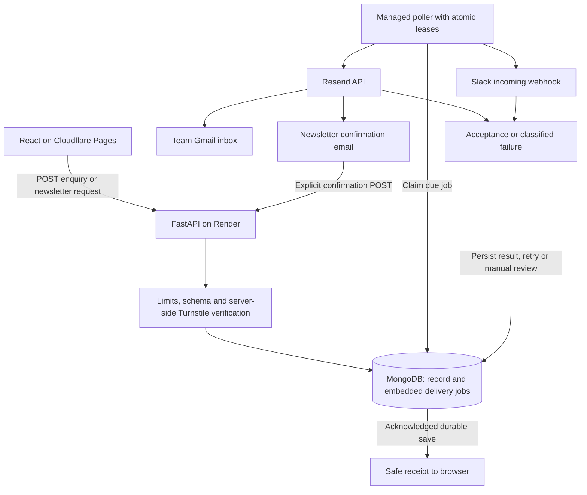

# The Harvest Theory: database-backed forms and production delivery design

**Date:** 2026-10-17

**Status:** Proposed design; implementation and publishing have not started.

**Companion:** [Bite-sized implementation plan](2026-10-17-production-forms-plan.md). This design explains decisions; the companion is the execution checklist.
**Repository baseline:** `main`, commit `5ea0ba7`; recheck before implementation.

## Intended outcome

A visitor can submit any of the nine enquiry forms, receive confirmation only after MongoDB saves it, and have the team notified through Resend email to its Gmail inbox and through Slack. Newsletter signup becomes a persisted, confirmed subscription with an unsubscribe flow. The React site runs on Cloudflare Pages and the FastAPI service runs on Render, using MongoDB Atlas.

All application code, local integration tests, simulated provider failures, build checks and deployment preparation can be completed without the user's provider credentials. Account setup, actual provider delivery, domain changes and production acceptance happen in a separate final stage after the user supplies details and authorizes publishing. A local test cannot satisfy that final stage.

## What exists today

| Surface | Source evidence | Current behavior / required change |
| --- | --- | --- |
| Enquiry forms | `frontend/src/pages/Contact.jsx`, `frontend/src/data/contact-options.js` | Nine schemas; submit only calls `setSent(true)`. No network request or persisted enquiry. Replace with an API-backed state machine. |
| Newsletter | `frontend/src/components/Footer.jsx`, `Newsletter()` | Email changes component state to “you're on the list.” No subscription exists. Extract and connect it to the backend. |
| Product and collection enquiries | `frontend/src/pages/ProductDetail.jsx`, `frontend/src/pages/CollectionDetail.jsx` | Links prefill `/contact?type=product-orders&item=...`. Preserve this behavior. Product ordering itself remains unavailable. |
| Backend | `backend/server.py` | Mongo connection plus greeting and template `GET/POST /api/status` routes. No enquiry, newsletter or notification implementation. |
| Tests | `backend/pytest.ini`, `tests/__init__.py` | No current business-flow test suite. Keep the required two xdist workers; isolate databases per test. Historical reports are not regression tests. |
| Dependency installation | `backend/requirements.txt`, `backend/scripts/generate_product_images.py` | `emergentintegrations==0.2.2` blocks installation from the configured registry; only the optional image generator needs it. Separate it from the web runtime. |
| Frontend tooling | `frontend/package.json`, `frontend/yarn.lock`, `frontend/craco.config.js` | React 19, CRA/CRACO, Yarn 1.22.22. Preserve this stack and lockfile; remove Emergent-only build tooling after verifying its references. |
| Secrets and delivery | `.gitignore`, tracked `backend/.env` and `frontend/.env` | Environment files are tracked; contents have not been reproduced in this review. Introduce ignored local files, templates and a private exposure review. No current CI/deployment configuration. |
| Publishing content | `frontend/src/components/Footer.jsx`, `frontend/src/data/products.js` | Privacy link is a placeholder; pricing and trust information include placeholders. Prepare the intake privacy page; owner reviews business facts before launch. Do not invent certifications, policies or prices. |

The earlier local runtime verification exercised the site, API and local MongoDB, but contact/newsletter were still frontend previews. The PUI index in this environment has incomplete symbol extraction; its impact output is only a file-level hint. This design also uses the existing Graphify output and direct source inspection, rather than treating “no affected tests” as proof of coverage.

## What is reused from ApexLink

References: [ApexLink design](../../../apexlinklogistics-web/docs/plans/2026-08-17-deployment-migration-design.md) and [ApexLink implementation plan](../../../apexlinklogistics-web/docs/plans/2026-08-17-deployment-migration-plan.md). These are precedents, not instructions to modify that repository.

| ApexLink approach | Harvest adaptation |
| --- | --- |
| Cloudflare Pages + Render + MongoDB + Resend + Slack | Retain the platform split. Keep product/journal content static. |
| Existing submissions and notifier classes | Build the intake backend here; those classes do not exist in Harvest. |
| Delete a confirmed public PII-list endpoint | Do not attribute ApexLink's exposure to Harvest. Remove Harvest's template status routes and never introduce public enquiry/subscriber list/detail APIs. |
| Background notification with exception handling | Persist notification jobs in the same document as the submission; lease, retry and recover them after restarts. |
| Free Render plus scheduled keep-alive | Recommend an always-on instance for prompt delivery. A free sleeping preview is a different service level, not equivalent production readiness. |
| `npm ci` and an assumed test suite | Use the existing Yarn lockfile; create tests before implementing business behavior. |
| Reusable CI called from deploy | Actually declare `workflow_call`; validate with an Actions-aware checker, not only YAML parsing. |
| Deploy hook response treated as success | Pin the tested commit, wait for backend readiness/version, then deploy and verify the frontend. |
| Emergent decommission after cutover | Conditional: first establish whether an existing deployment/domain is in use. No automatic account deletion. |

## Decisions and scope

**Recommended:** keep React/CRA and FastAPI, use MongoDB as the source of truth, and run a small durable notification poller in the FastAPI lifespan on one always-on Render web service. Atomic job leases allow overlapping deploys and later multiple processes safely. This avoids adding Redis or another service for modest enquiry volume. Extracting the poller to a dedicated worker is a future scaling option.

Alternatives considered: fire-and-forget tasks are simpler but can disappear on process termination; a separate Render worker isolates processing but adds another service to operate; a Cloudflare-only backend would require a broader runtime/database redesign. Neither broader migration is required to make these forms work.

“Realtime” here means immediate database acknowledgement and prompt asynchronous notification. Proposed healthy-system targets are API acknowledgement p95 under 2 seconds, excluding the anti-bot verification round trip, and first notification attempt within 10 seconds of save. Provider acceptance should normally follow within 30 seconds. These are acceptance targets to measure, not guarantees of Gmail inbox arrival or Slack availability. No WebSocket dashboard is in scope.

Gmail is assumed to be the **recipient inbox**, not an SMTP integration. Resend sends from a verified address on an owned domain; enquiry replies use the visitor's validated email as `reply_to`. No Gmail password, app password or OAuth integration is required for this design. Resend documents the owned-domain requirement in its [domain guide](https://resend.com/docs/dashboard/domains/introduction).

Included: nine enquiry types, confirmed newsletter signup/unsubscribe, validation, duplicate handling, abuse controls, reliable notifications, local tooling, CI, deployment configuration, operational recovery, privacy information and launch evidence.

Excluded: checkout, payments, inventory, order fulfilment, shipping calculations, CRM/admin dashboard, automated newsletter campaigns, customer enquiry acknowledgement emails, Gmail mailbox reading, unrelated freight-broker integration and a framework redesign. A “Product Orders” form captures an **enquiry**, not a completed purchase.

## Request and delivery flow



### Enquiry contract

`POST /api/enquiries`, with `Content-Type: application/json` and an `Idempotency-Key` containing a UUID. Example:

```json
{
  "type": "general",
  "fields": {"name": "Local Test", "email": "visitor@example.test", "message": "A product question"},
  "privacy_notice_version": "2026-10-17",
  "source_path": "/contact",
  "website": "",
  "turnstile_token": "provided-by-widget-in-production"
}
```

New accepted enquiry: HTTP `201`, `{"id":"<uuid>","status":"received"}`. An identical key and normalized payload returns the same receipt with `200`; changed payload under that key returns `409`. No provider result or personal data is returned. Validate bounded JSON and the request shape before lookup; replay a saved matching receipt before revalidating a single-use Turnstile token. If the first attempt did not persist, require a fresh challenge token on retry. Exclude the challenge and honeypot from the business-payload hash.

Validation failures: `422` with safe field identifiers and messages; malformed JSON `400`; body too large `413`; failed bot check `400`; rate limit `429` with `Retry-After`; unavailable database or challenge service `503`. Unexpected errors return a generic `500` and a request ID. Do not serialize Pydantic's submitted `input` values into error responses or logs.

Schema parity is tested against the frontend's nine types. Required fields remain exactly as they are today; optional fields remain optional. Reject unknown fields and non-string values. Trim outer whitespace; validate email; bound names/company/publication to 160 characters, other short text to 500, email to 254, phone to 40 and textareas to 5,000. Enforce a 32 KiB request limit while streaming, including bodies without Content-Length. Keep user text as text: escape it for HTML and avoid interpreting it as Slack markup. `source_path` is a bounded relative path without query/fragment, not a redirect or arbitrary external URL.

### Newsletter lifecycle

`POST /api/newsletter` accepts email, explicit `consent: true`, notice version, relative source path, honeypot and challenge token. Return the same `202` generic receipt for new, pending and already subscribed addresses. Normalize email for a unique index using a documented case-insensitive policy; do not strip plus-tags or dots.

State transitions: `pending → subscribed → unsubscribed`; a new explicit signup after unsubscribe goes through `pending` again. A pending request queues one confirmation email; duplicates within 10 minutes queue nothing. A later resend creates a new generation and invalidates older confirmation tokens. An already subscribed address does not receive repeated confirmation emails. On first confirmation per generation, atomically set consent/confirmation timestamps and enqueue team email and Slack jobs once.

Use signed, expiring tokens with required issuer, audience, purpose, subscriber ID, generation and expiry. Confirmation lifetime: 24 hours. Unsubscribe lifetime: 90 days for this initial confirmation message; future campaigns must issue fresh links. Validate the stored generation and state. Use `POST /api/newsletter/confirm` and `POST /api/newsletter/unsubscribe`; GET pages only display an explicit action button, so link previews cannot change membership. Put tokens in URL fragments and clear them after capture; use `Referrer-Policy: no-referrer` on these pages. Invalid/expired tokens get a generic error and a signup-again link; repeated valid actions are safe. Newsletter emails include an unsubscribe link.

Consent is specific to the newsletter; enquiries never enrol visitors in marketing. UI receipt says “Check your email to confirm your subscription.” Only successful confirmation says “You're subscribed.” This ships list membership and lifecycle, not a campaign sender.

### MongoDB records and indexes

Use BSON UTC datetimes. Use PyMongo's supported async client for the new implementation, with its own lifespan/event loop; the current Motor template is a small migration surface. MongoDB recommends migration in its [async driver guide](https://www.mongodb.com/docs/languages/python/pymongo-driver/current/reference/migration/).

| Collection | Key fields | Required indexes |
| --- | --- | --- |
| `enquiries` | UUID `_id`, schema version, type, validated fields, received_at, notice version, source path, idempotency key, payload hash, immutable delivery payloads and job states | Unique idempotency key; received_at; per-channel state/next_attempt_at and lease expiry |
| `newsletter_subscribers` | UUID `_id`, canonical email, state, consent and confirmed/unsubscribed timestamps, notice version, generation, expiry, last confirmation enqueue time, embedded jobs | Unique canonical email; state; per-channel due/lease indexes |
| `rate_limits` | HMAC scope/window key, count, expires_at | Unique `_id`; TTL on expires_at |
| `service_heartbeats` | Process ID, release SHA, last successful worker tick | Last tick / expiry cleanup |

Create indexes idempotently before accepting traffic; a failed required index means readiness fails. Use acknowledged writes with `w=majority` and a bounded timeout in Atlas. An insertion timeout can have an unknown outcome: respond retriable and resolve by the same idempotency key, never claim the record definitely failed. Tests include both standalone local Mongo and a CI replica set with production write concern.

Store enquiry and both pending jobs in **one insert**, and newsletter transitions and jobs in **one conditional update**. This avoids the gap between saving a record and inserting into a separate queue; no cross-document transaction is required. An invalid schema never becomes a notification job.

### Notification worker and failure semantics

Each fixed job slot stores `job_id`, generation, channel, immutable provider payload, `state`, `attempts`, `next_attempt_at`, lease owner/expiry, first_attempt_at, accepted_at, provider ID and a sanitized error code. Provider payload snapshots can contain personal data and newsletter bearer links: restrict database access, never log/export them, and redact them after the configured retention period. Do not pretend that queued confirmation links are absent from storage.

Claim using `find_one_and_update` with a due-state predicate and expired-or-empty lease. Commit results only when job ID, generation and lease owner still match. Lease 60 seconds; HTTP timeout 10 seconds; bounded concurrency of 2 initially. Poll every 2 seconds with a small jitter; a failed database tick backs off instead of terminating the loop. Graceful shutdown stops claims, waits a bounded time and leaves incomplete leases recoverable.

Retry network errors, `429` and `5xx`; respect bounded `Retry-After`. Use persisted backoff of 5s, 30s, 2m, 10m, 30m and 2h, with jitter; at most 8 attempts and never automatic replay more than 23 hours after first attempt. Classify other `4xx` as terminal, except documented transient provider cases. Track `pending`, `sending`, `retry`, `accepted`, `dead` and `unknown` distinctly. A timeout after possible send is `unknown` and eligible for policy-controlled retry within the window. Exhaustion remains visible for operator action.

Resend: send an immutable payload and a stable `Idempotency-Key` per job; store its returned ID. Its deduplication window is [24 hours](https://resend.com/docs/dashboard/emails/idempotency-keys). Older ambiguous sends require reconciliation, not automatic re-keying. Slack incoming webhooks have no deduplication contract relied on here: a crash after sending can produce a duplicate on recovery. Include the same enquiry/job reference in every retry and document **at-least-once** delivery; do not promise exactly-once notifications. Slack receives type, time and reference only, with no email, phone or free-text body. See Slack's [webhook documentation](https://docs.slack.dev/messaging/sending-messages-using-incoming-webhooks/).

One provider failure cannot stop the other provider. An `accepted` email means Resend accepted it; it does not prove delivery to Gmail. An HTTP webhook success also needs actual channel observation at launch. No fake/local adapter may write `accepted`; it writes `simulated`, and production configuration refuses fake adapters.

## Public intake safeguards and privacy

Use exact CORS origins, no credentials/cookies, bounded POST routes, no public read APIs, escaped email rendering and fixed server-owned recipients/URLs. `From`, recipient, webhook URL and notification subject prefixes cannot be supplied by the visitor. CORS alone is not authorization or bot protection.

Use Cloudflare Turnstile with backend Siteverify verification, expected hostname/action checks and explicit local fake mode. Tokens are single-use and expire after five minutes, so UI retry must refresh them. The [server validation guide](https://developers.cloudflare.com/turnstile/get-started/server-side-validation/) explains these constraints. Do not allow fake mode in a production build or API process.

Apply a Mongo-backed per-IP intake window (initially 10 requests / 10 minutes), an email confirmation cooldown (10 minutes), and an overall configurable intake circuit breaker (initially 300 requests / hour). Counts use atomic updates, not process memory. Values are initial operational settings, not a measured capacity claim. Hash IP identifiers with a server secret; never trust arbitrary `X-Forwarded-For` or `CF-Connecting-IP` on a directly reachable origin. Render's trusted proxy behavior must be verified during final setup; uncertainty blocks enabling per-IP claims. Turnstile, email cooldown and the global cap still need independent tests.

Provide a real `/privacy` page describing the data collected, purpose, processors, contact and retention. Draft owner-specific facts for review; do not invent legal identity or legal compliance certification. Proposed operating retention: enquiries 180 days, unconfirmed signups 7 days, completed notification payloads 7 days, redacted job outcomes 30 days, unsubscribed email suppression retained only under an owner-approved policy. Confirm these values before public launch and document deletion/backup implications. Never automatically delete pending/dead jobs without review. Retention code supports dry run and exact scope.

## Hosting, builds and operations

Cloudflare Pages serves `frontend/build`. Choose a Direct Upload project for GitHub Actions deployment and preserve SPA deep links; the [Direct Upload guide](https://developers.cloudflare.com/pages/get-started/direct-upload/) documents this mode. API URLs and Turnstile site keys in CRA are **public build-time values**; provider secrets never use `REACT_APP_*`.

Render runs `uvicorn server:app --host 0.0.0.0 --port "$PORT" --workers 1` with the managed poller. `/api/health/live` is process liveness, `/api/health/ready` checks Mongo/indexes/worker-loop health, and `/api/version` returns only the release SHA. An email/Slack outage must not disable otherwise durable intake. Provider queue health is monitored separately. Database credentials grant only this app's database access; Atlas network rules use verified Render egress ranges.

Render's [free-service documentation](https://render.com/docs/free) says a free web service sleeps after 15 minutes without inbound traffic and explicitly positions free instances outside production use. An always-on instance is therefore the recommendation for this design. Do not create a keep-alive workflow or promise a $0 production stack. Select plan, region, backups and budget at the final provider stage; no paid resource is purchased by this planning task.

CI tests backend with isolated MongoDB, frontend behavior, browser flows and production build. A manually triggered release workflow first tests the selected `main` SHA, deploys that same backend SHA, waits for its health/version, and uploads the artifact built with the final public configuration. Disable independent provider auto-deploy paths. Keep the release workflow inert until setup is complete. Render supports a commit `ref` on its [deploy hook](https://render.com/docs/deploy-hooks); a hook response starts a deployment rather than proving completion. Reusable Actions workflows require [`workflow_call`](https://docs.github.com/en/actions/how-tos/reuse-automations/reuse-workflows).

Operators use local/authorized server CLI commands for queue counts, inspecting a specific record, recovery, retention and export/deletion. No anonymous admin HTTP route is added. Logs contain request/job references, timings and sanitized error classes, never bodies, emails, tokens, connection strings or webhook URLs. The worker emits queue age, dead-job count and heartbeat signals. A separate public `/api/health/delivery` exposes only `ok` or `degraded` with 200/503, never queue details or identifiers; degradation does not stop intake readiness. A scheduled GitHub Actions monitor checks this signal and liveness, with the owner configured to receive failed-workflow notifications. This is best-effort monitoring, not a keep-alive mechanism or an availability guarantee. Launch must verify the alert route and backup/restore process; a free database tier is not automatically a backup solution.

## Readiness gates and final user inputs

| Gate | Required evidence | Can finish without provider credentials? |
| --- | --- | --- |
| A: code ready | All nine schemas; duplicate/error cases; newsletter lifecycle; worker recovery; safe configuration and regression tests | Yes |
| B: locally integrated | Real local Mongo, browser submissions, simulated Resend/Slack requests, restart/retry proof, production build and deployment validation | Yes |
| C: provider connected | Atlas access/indexes; Resend domain and sender; Gmail destination; Slack channel; Render health; Pages preview; Turnstile; costs and retention confirmed | No |
| D: publish accepted | Same test reference in browser, Atlas, Resend, Gmail and Slack; confirmed newsletter/unsubscribe; final-domain TLS/CORS/deep links; measured timing; rollback and monitoring evidence | No |

Request the following only after Gate B is complete:

| Provider / owner input | Needed at final setup | Storage |
| --- | --- | --- |
| Gmail | Team recipient address(es), person who checks receipt/reply; optionally a distinct support reply-to address | Backend configuration; no Gmail password |
| MongoDB | URI, dedicated app database/user, region, egress rules, tier and backup/retention decision | Render secret environment |
| Resend | Scoped send key, owned verified sending domain/address, delivery/quota access | Render secrets/configuration |
| Slack | Target workspace/channel, incoming webhook, explicit permission for labelled acceptance messages | Render secret environment |
| Render | Account/service, region, approved always-on plan, deploy hook and API token for deployment status | GitHub protected environment for deploy secrets; runtime secrets on Render |
| Cloudflare | Account/project, domain/zone, scoped Pages token, DNS access, Turnstile site/secret keys and hostnames | Deploy secrets in GitHub; Turnstile secret on Render; site key public |
| GitHub and business owner | Environment/branch controls, final domain, privacy contact/identity, policies, owners and publishing approval | Repository settings and reviewed documentation |

Credentials should be entered into provider secret stores or a secure local mechanism, not committed or pasted into plans. The owner approves the concrete deployment, cost and test-message destinations at the final stage. Domain change comes after preview acceptance. If an existing site serves traffic, preserve its settings for rollback and retire it only after a successful observation period. Deployment approval is not authorization to delete an account.
